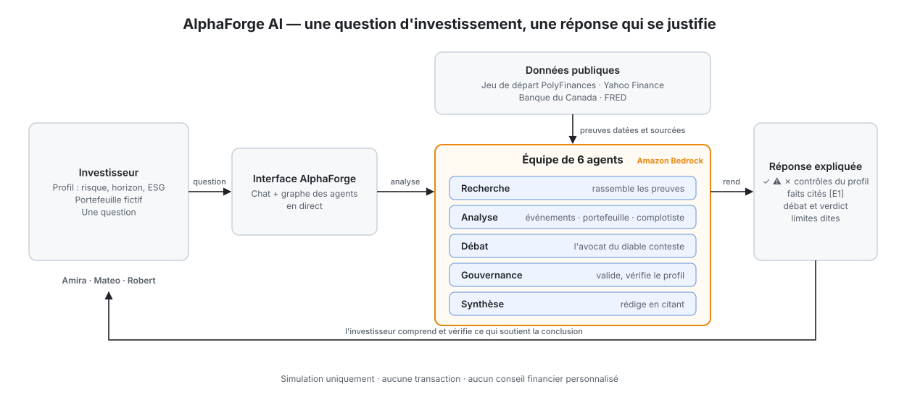

# AlphaForge AI

Assistant agentique **auto-explicatif** pour éclairer une décision d'investissement selon le profil de l'investisseur
(Datathon PolyFinances 2026). Une équipe de 6 agents (LangGraph, **Amazon Bedrock**) analyse une question sur un
portefeuille fictif, débat de ses propres conclusions et ne rend que ce que les preuves permettent d'affirmer.
Simulation uniquement : aucune transaction, aucun conseil financier personnalisé.



Architecture détaillée : [`docs/diagrams/architecture-technique.svg`](docs/diagrams/architecture-technique.svg)
(régénérer les schémas : `python docs/diagrams/build_diagrams.py`).

```
question + profil + portefeuille (interface React)
   └─► API Flask (/api/analyze/stream)
         └─► Recherche : actualités, prix, métriques de risque, contrôles du profil  ──►  preuves E1, E2… (créées par le code)
               ├─ Événements ─┐
               ├─ Storyteller ┼─► Avocat du diable ─► réponses (tour 2) ─► Gouvernance ─► Synthèse (+ Guardrail)
               └─ Complotiste ┘
```

| Agent | Rôle | Modèle |
|---|---|---|
| Recherche (`team/research.py`) | Rassemble et date les preuves ; aucun chiffre n'est produit par un LLM | Haiku |
| Événements (`team/events.py`) | Repère et date les événements dans les actualités | Haiku |
| Storyteller (`team/portfolio.py`) | Explique l'impact sur **ce** portefeuille, en mots simples | Haiku |
| Complotiste (`team/conspiracy.py`) | Test de robustesse : théories délibérément paranoïaques, toujours « non prouvées » | Haiku |
| Avocat du diable (`team/devil.py`) | Conteste les conclusions ; les agents visés répondent au tour 2 | Sonnet |
| Gouvernance (`team/governance.py`) | Valide ou rejette chaque affirmation, vérifie le profil, plafonne le verdict | Sonnet |
| Synthèse (`team/graph.py`) | Réponse finale en 6 sections, chaque chiffre cité `[E…]` | Sonnet + Guardrail |

Sans aucune donnée pertinente (ex. « c'est quoi un ETF ? »), un seul appel répond en connaissances générales, signalé comme non vérifié.

## Démarrage

```bash
python -m venv .venv && .venv/bin/pip install -r <(python -c "import tomllib;d=tomllib.load(open('server/pyproject.toml','rb'));print('\n'.join(d['project']['dependencies']+['pytest>=8']))")
cp .env.example .env                                   # puis renseigner les routes Bedrock et les ressources AWS
mkdir -p data/starter && cp ../alphaforge_starter/*.csv data/starter/   # jeu de départ PolyFinances (non versionné)
.venv/bin/python -m alphaforge upload-datasets         # envoie data/datasets et data/starter vers S3 (si STORAGE_BACKEND=s3)
.venv/bin/python -m server.src.risk.build_front_data   # recalcule alphaforge-ai/src/data/universe.json (statistiques réelles)
.venv/bin/flask --app server.src.main run --port 5000  # API
cd alphaforge-ai && npm install && npm run dev         # interface sur http://localhost:5173 (proxy /api -> :5000)
.venv/bin/python -m pytest -q                          # tests (aucun appel AWS)
```

Sur la page d'accueil, **« Or try a reference persona »** charge Amira, Mateo ou Robert (profil + portefeuille fictif + question type).

## Déploiement en ligne

```bash
python deploy/deploy.py   # image Docker (ARM64) -> ECR, puis pile CloudFormation deploy/alphaforge.yaml ; affiche l'adresse HTTPS
```

Navigateur → **CloudFront** (HTTPS) → **Application Load Balancer** (joignable seulement par CloudFront) → **ECS Fargate**
(un conteneur : interface compilée + API gunicorn) → Bedrock, Guardrail, S3, CloudWatch avec le **rôle IAM de la tâche**.
Aucun identifiant dans l'image ni dans la pile : seule la configuration non secrète du `.env` est transmise. Le flux SSE
envoie un battement toutes les 15 s (délai CloudFront de 60 s) ; `ANALYSES_PER_HOUR` (60 par défaut) plafonne le coût Bedrock
du site public, en plus de la limite de 10 analyses par minute et par IP. Redéployer après un changement : relancer la commande.

## Services AWS

| Service | Usage dans le flux |
|---|---|
| Amazon Bedrock (Converse) | Les 7 rôles LLM ; routage par tâche avec repli (`LLM_ROUTES`), coût par appel (`LLM_PRICING`) |
| Bedrock Guardrails | Appliqué à la synthèse et aux réponses générales (sujet refusé : promesses de gains garantis) |
| Amazon S3 | Jeu de départ (`starter/`), jeux d'évaluation, **archive de chaque analyse** (`reports/analyses/<request_id>.json`) |
| Amazon CloudWatch | Logs JSON (`/alphaforge/app`) et métriques EMF de chaque appel de modèle |
| Bedrock Knowledge Base | Branchée par `KNOWLEDGE_BASE_ID` ; désactivée tant qu'elle ne contient que le document d'exemple fictif |

## Sources de données

Chaque chiffre de l'analyse est une **preuve** (`E1`, `E2`…) créée par le code, avec sa source et sa date ; les agents ne font que la citer.

| Preuve | Source | Détail |
|---|---|---|
| `metric` | **Jeu de départ PolyFinances** (cours ajustés Yahoo Finance, 2021-11-12 → 2026-11-12 ; USD/CAD Banque du Canada) ; Yahoo en direct pour un actif hors univers | Volatilité, VaR / CVaR historiques 95 %, baisse maximale, bêta vs S&P 500 (SPY), part du risque par ligne, nombre effectif de lignes, corrélation moyenne (1 an) ; prévision GARCH + Monte Carlo (historique complet) ; **simulation « et si »** d'un actif cité mais non détenu (poids 10 %) ; taux et inflation (Banque du Canada, FRED) si le portefeuille contient des obligations |
| `check` | Règles AlphaForge (ci-dessous) sur le jeu de départ | Contrôles déterministes du profil |
| `price` | Yahoo Finance en direct | 10 dernières séances des actifs cités |
| `news` | Éditeur d'origine via Yahoo Finance (ex. « Motley Fool (via Yahoo Finance) ») | 5 articles au plus par actif cité |

- L'interface affiche les **statistiques réelles** des 31 actifs du jeu de départ (rendement annualisé, volatilité, baisse maximale,
  corrélations) et des **rejeux historiques** (2022, pire et meilleur mois du S&P 500, 2023, 12 derniers mois) au lieu de scénarios inventés.
- Traitements : rendements sur `adj_close` ; CAD convertis au taux de la Banque du Canada (dernier taux reporté les jours fériés) ;
  calendriers alignés sur les jours communs (mouvements crypto du week-end reportés au lundi) ; IPC daté du mois de référence, pas de publication.
- Limites : biais du survivant (univers choisi en 2026) ; aucune note ESG dans les données (l'ESG est traité par secteur) ;
  mesures du passé, pas des promesses.

## Contrôles de profil (`server/src/risk/checks.py`)

Règles déterministes, visibles dans le chat (✓ / ⚠ / ✗) et opposables à la gouvernance : un contrôle « non respecté » interdit
de déclarer le profil cohérent. Les seuils sont des **hypothèses de conception** documentées ici.

| Contrôle | Prudent | Équilibré | Audacieux |
|---|---|---|---|
| Volatilité annuelle du portefeuille (⚠ au-delà, ✗ au-delà de 1,5×) | 8 % | 12 % | 18 % |
| Poids d'une seule action ou crypto | 20 % | 25 % | 35 % |
| Concentration sectorielle (actions individuelles) | 40 % | 50 % | 60 % |
| Cryptoactifs (✗ si interdit) | 0 % | 5 % | 10 % |
| Volatilité d'un actif demandé mais non détenu | 25 % | 35 % | — |
| Nombre effectif de lignes (tous profils) | ≥ 3 | ≥ 3 | ≥ 3 |

Plus : horizon ≤ 5 ans et actif demandé à plus de 30 % de volatilité (⚠) ; préférence ESG et exposition au secteur Énergie
(⚠ « ESG-aware », ✗ « strong ») ; exclusions déclarées (✗). Personas de l'énoncé testés dans `tests/test_personas.py`.

## Voir le raisonnement des agents

- **Dans le chat** (*Scenario Analysis*) : graphe des agents en direct, contrôles de profil, réponse citée `[E…]`.
- **Page Debug** : bouton 🐛 en haut de la réponse, ou `/debug` (sortie de chaque agent, débat, preuves).
- **MLflow** (`MLFLOW_TRACING=true`, puis `mlflow ui --backend-store-uri sqlite:///mlflow.db --port 5001`) : prompt, réponse brute,
  modèle et tokens de chaque appel.
- **S3** : rapport complet de chaque analyse archivé (`reports/analyses/`).

## Utilisation

```powershell
python -m alphaforge check-routes                      # teste chaque modèle configuré
python -m alphaforge ask "Quels sont les risques d'Alpha Inc. ?" --persona prudent [--doc fichier.txt]
python -m alphaforge analyze "Pourquoi NVIDIA a baissé ?" --ticker NVDA --news n.json --prices p.json --portfolio pf.json   # 5 agents + débat
python -m pytest -q                                    # tests (aucun appel AWS)
python -m alphaforge upload-datasets                   # envoie ./data/datasets vers le stockage configuré (S3)
python -m alphaforge evaluate --dataset golden_v1 --mlflow
python -m alphaforge evaluate --save-baseline          # enregistre la référence
python -m alphaforge evaluate --baseline               # code de sortie 1 si régression
mlflow ui --backend-store-uri sqlite:///mlflow.db
```

**Sans AWS** : laissez `LLM_ROUTES` par défaut (mock) et `STORAGE_BACKEND=local`. Une variable d'environnement qui redéfinit
`LLM_ROUTES` est fusionnée avec celle du `.env` : pour passer en local, modifiez le `.env`.

## Configuration (`.env`)

| Variable | Défaut | Rôle |
|---|---|---|
| `LLM_ROUTES` | mock | `{"tâche": ["fournisseur:model_id", ...]}`, fallback dans l'ordre ; tâches `orchestration`, `agent`, `evaluation`, `arbitration` (avocat du diable + gouvernance ; sans route : reprend `orchestration`, **sans Guardrail**), `default` ; fournisseurs `mock`, `bedrock` |
| `LLM_MAX_TOKENS` | 2048 / 8000 / 6000 / 6000 / 600 | Limite de sortie par tâche (trop bas = réponses tronquées, événement `truncated`) |
| `LLM_PRICING` | `{}` | `{"model_id": {"input_per_1m": x, "output_per_1m": y}}` en USD ; vide = coût « inconnu » |
| `AWS_REGION` / `AWS_PROFILE` | `us-east-1` / vide | Région ; profil local (sinon chaîne par défaut de boto3 : rôle IAM, variables) |
| `BEDROCK_TIMEOUT_SECONDS`, `BEDROCK_MAX_RETRIES` | `60`, `3` | Délai et nouvelles tentatives |
| `GUARDRAIL_ID`, `GUARDRAIL_VERSION`, `GUARDRAIL_TASKS` | vide, `DRAFT`, `["orchestration"]` | Guardrail Bedrock (jamais sur `evaluation`) |
| `KNOWLEDGE_BASE_ID` | vide | Knowledge Base Bedrock : documents dans S3, **Sync** depuis la console |
| `STORAGE_BACKEND`, `LOCAL_STORAGE_DIR` | `local`, `./data` | `local` ou `s3` |
| `S3_BUCKET`, `S3_PREFIX` | vide, `alphaforge` | Bucket S3 |
| `CLOUDWATCH_LOG_GROUP`, `CLOUDWATCH_RETENTION_DAYS`, `CLOUDWATCH_METRICS` | vide, `14`, `false` | Logs et métriques (EMF) vers CloudWatch |
| `LOG_LEVEL`, `MLFLOW_TRACKING_URI`, `MLFLOW_EXPERIMENT` | `INFO`, `sqlite:///mlflow.db`, `alphaforge` | |
| `MLFLOW_TRACING` | `false` | Une trace par analyse : span par agent et par appel de modèle (onglet **Traces** de `mlflow ui`). Contient prompts et réponses : développement uniquement |

Ne jamais mettre d'identifiants dans le code ; le `.env` est ignoré par git. Les jetons d'atelier expirent (`ExpiredToken` : les recopier).
Sous Git Bash, ne pas exporter `/alphaforge/app` en variable d'environnement (converti en chemin Windows) : le mettre dans le `.env`.

## Comportement

- **Fallback** de modèle sur indisponibilité, limite de débit ou délai dépassé (pas sur une requête invalide). Erreurs typées.
- **Résilience** : un agent ou la Knowledge Base en panne ne fait pas échouer la requête (résultat dégradé, événement journalisé).
- **Logs JSON** : `request_id`, `model_call` (modèle, latence, tokens, coût), `agent_error`, `retrieval_error`, `truncated`,
  `guardrail_intervened`, `request_end`. Jamais de prompt, de question ni d'identifiant.
- **Coût** : tokens × `LLM_PRICING` ; `None` si un prix manque (jamais deviné). Estimation, pas la facture AWS.
- **Évaluation** : règles (mots attendus/interdits, promesses interdites) + juge LLM 1-5 ; `evaluate` n'utilise pas la Knowledge Base sauf `--with-kb`.

## Permissions IAM

Rôle de la tâche ECS, ou profil en local (à resserrer à vos ressources) :

```json
{"Version": "2012-10-17", "Statement": [
  {"Effect": "Allow", "Action": ["bedrock:InvokeModel"],
   "Resource": ["arn:aws:bedrock:*::foundation-model/*", "arn:aws:bedrock:*:<ACCOUNT_ID>:inference-profile/*"]},
  {"Effect": "Allow", "Action": ["bedrock:ApplyGuardrail"], "Resource": "arn:aws:bedrock:*:<ACCOUNT_ID>:guardrail/*"},
  {"Effect": "Allow", "Action": ["bedrock:Retrieve"], "Resource": "arn:aws:bedrock:*:<ACCOUNT_ID>:knowledge-base/*"},
  {"Effect": "Allow", "Action": ["s3:GetObject", "s3:PutObject"], "Resource": "arn:aws:s3:::<BUCKET>/alphaforge/*"},
  {"Effect": "Allow", "Action": ["s3:ListBucket"], "Resource": "arn:aws:s3:::<BUCKET>"},
  {"Effect": "Allow", "Action": ["logs:CreateLogGroup", "logs:CreateLogStream", "logs:PutLogEvents", "logs:PutRetentionPolicy"],
   "Resource": "arn:aws:logs:*:<ACCOUNT_ID>:log-group:/alphaforge/*:*"}
]}
```

`bedrock:InvokeModel` sur un profil d'inférence `global.`/`us.` exige aussi les modèles sous-jacents (d'où `foundation-model/*`).
Les logs CloudWatch n'ont besoin d'un droit applicatif que si `CLOUDWATCH_LOG_GROUP` est défini ; avec le pilote `awslogs` d'ECS,
c'est le rôle d'exécution qui écrit.

## Limites connues

- Une analyse complète prend environ 100 s (3 rôles sur Sonnet) et coûte environ 0,17 $ ; le graphe en direct rend l'attente visible.
- Le verdict de la gouvernance varie d'une exécution à l'autre (modèle stochastique) ; les contrôles de profil, eux, sont déterministes.
- Aucune note ESG dans les données : l'ESG est évalué par l'exposition sectorielle (Énergie), ce que l'application dit explicitement.
- Les identifiants AWS d'atelier expirent (`ExpiredToken`) : les recopier dans le `.env`. Sans S3, le jeu de départ est lu dans `./data/starter`.
- Les 3 agents de la commande `ask` (premier prototype, hors application) sont des squelettes.
- En ligne, une seule tâche ECS (limites de débit en mémoire) : pas de mise à l'échelle horizontale.
- Yahoo Finance peut limiter les requêtes venant d'adresses cloud : les actualités peuvent alors manquer (signalé dans la réponse) ;
  les métriques, elles, viennent du jeu de départ sur S3.
- Tests : `tests/test_team.py` (6 agents, fournisseur scripté), `tests/test_risk.py` (calculs), `tests/test_personas.py`
  (Amira, Mateo, Robert sur les vraies données), `tests/test_server.py` (API et flux SSE).
